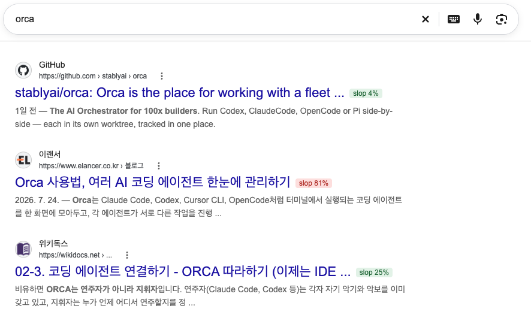

# Slop Guard



구글 검색 결과에 AI slop 확률 배지를 붙이고, 외부 링크를 열 때 80% 이상이면 경고하는 Chrome 확장. 판정은 [TypeSafe Jev](https://typesafe.ai)를 이용한다. Jev API 혹은 Vercel AI Gateway 키가 필요하다.

## 설치

1. 이 레포지토리를 `git clone`하거나 zip download
2. 크롬 브라우저에서 `chrome://extensions` → 개발자 모드 → 압축해제된 확장 프로그램 로드 → 이 폴더 선택
3. 자동으로 열리는 설정 페이지에 Jev API 키 입력 (Vercel AI Gateway 키일 경우 체크박스 켜기)

## 동작

- **검색 결과**: 제목 옆에 `slop 87%` 배지 (초록 <50%, 주황 <80%, 빨강 ≥80%). 마우스를 올리면 근거.
- **링크 클릭**: 외부 링크면 먼저 검사하고, 80% 이상이면 확인창.
- **판정**: 페이지 URL과 본문을 Jev에 보내 질문 9개를 묻는다. 점수는 `slop` 하나로 정하고, 나머지는 근거 표시용. 공식문서, 위키, 언론 등 공신력 있는 출처의 경우 최대 절반까지 slop 점수를 낮춰준다.

## 조정

| 무엇 | 어디 |
|---|---|
| 판별 기준 문구 | `questions.js` |
| 경고 기준 (0.8) | `content.js` `THRESHOLD` |
| 공신력 감면 폭 (0.5) | `questions.js` `AUTHORITY_DISCOUNT` |

## 주의

- 검사하는 페이지의 URL과 본문이 TypeSafe/Vercel로 전송된다.
- 검색 한 번에 결과 수만큼 API 요청이 나간다. 예산 한도를 정해놓기를 권장한다.
- 검사 안 함: 같은 사이트 내 이동, cmd/휠 클릭, 주소창 입력, 구글 외 검색엔진.

## 테스트

```bash
node extract.test.mjs
```
